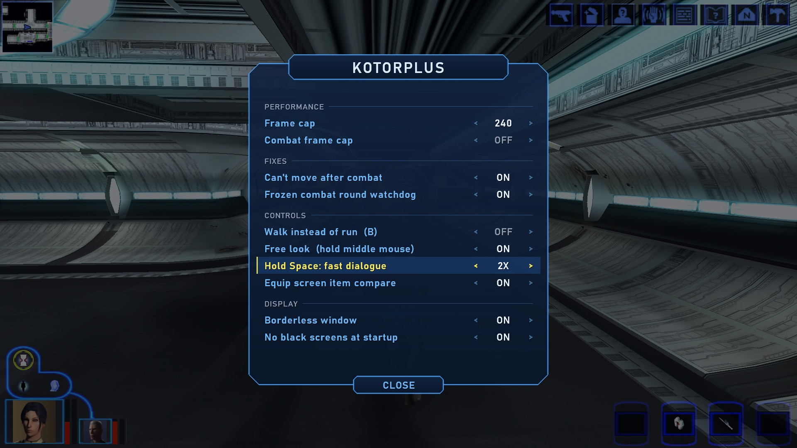
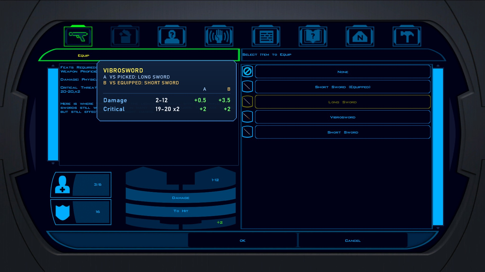

# KotorPlus

An engine add-on for **Star Wars: Knights of the Old Republic** (PC, v1.03, Steam or GOG) that fixes the
"can't move after combat" bug at its root and adds quality-of-life features in the game's own UI style.

Download for players: [Nexus Mods](https://www.nexusmods.com/kotor/mods/1927)



## Features

- **Stuck-after-combat fix** without the usual 60 fps cap (details below)
- **No black screens at startup**: blocks the game's display-mode switches when running windowed/borderless
- **Borderless window**, any resolution, alt-tab without a renderer rebuild
- **Frame cap** (60-240 or uncapped), low-CPU pacing
- **Settings panel** in KOTOR's style: F8 anywhere, or the KOTORPLUS button injected into the Options screen
- **Equipment comparison card**: hover an item to see its stats against your pick and your equipped item
  
- **Hold Space for 2x/3x/4x dialogue** (game clock and voice streams sped up together)
- **Free look**: hold middle mouse to look around while A/D steer
- Walk/run toggle, Ctrl+F12 screenshot of the final frame, F10 emergency unstick, F9 diagnostics

## The stuck-after-combat bug

When an attack animation ends, the client creature's "drive animation blocked" flag (`CSWCCreature+0x13C`)
can be left set. `CClientExoAppInternal::ProcessInput` lets the player break out: while a direction is held,
a 0.3 s timer runs, then it unblocks only if `CSWPlayerControlCamRelative::GetCurSpeed() > 0.25`.
But the same code zeroes the drive input while that timer runs, so the speed it measures is always 0 and it
retries forever. Verified live: 38 of 38 checks read 0.000. KotorPlus removes the speed test
(a 2-byte `jne` → `nop nop` at `0x623BB2`), so holding a direction always frees the character.

## How it works

`dinput8.dll` proxy: forwards `DirectInput8Create` to the system DLL and, on load:

- hooks `SwapBuffers` / `ChangeDisplaySettingsA` through the import table (frame pacing, overlay, hotkeys)
- patches engine code in memory; every patch verifies the original bytes first and is skipped on mismatch
- on the Steam exe (SteamStub-encrypted) it waits until the code is unpacked before patching
- draws its UI with its own OpenGL context on the game window (anti-aliased font atlas built with GDI)

Nothing on disk is modified; `swkotor.exe` stays stock.

## Building

Requires Visual Studio 2022 Build Tools (C++ x86).

```
build_public.cmd   -> out_public\dinput8.dll   (the released version)
build.cmd          -> out\dinput8.dll          (developer build, includes an experimental companion driver)
```

### Build on Linux

Needs Wine, Python 3, `git`, `msitools`, `unzip` and `binutils`. The setup downloads MSVC 2022 (x86) and the
Windows SDK through [msvc-wine](https://github.com/mstorsjo/msvc-wine) into `$MSVC_WINE_DIR` (default `~/opt/msvc`);
running it accepts Microsoft's licence terms.

```
tools/setup-msvc-wine.sh
./build.sh                 -> out/dinput8.dll   (--public -> out_public/dinput8.dll)
```

Copy `dinput8.dll` and `KotorPlus.ini` next to `swkotor.exe`. `KotorPlus.log` lists every applied patch.

## Credits

- Function addresses: [KotOR Patch Manager](https://github.com/LaneDibello/Kotor-Patch-Manager) address database by LaneDibello (MIT)
- KotorPlus by Mistlight Studios. Code, reverse engineering and docs were written with Claude (Anthropic).

## License

MIT, see [LICENSE](LICENSE).
